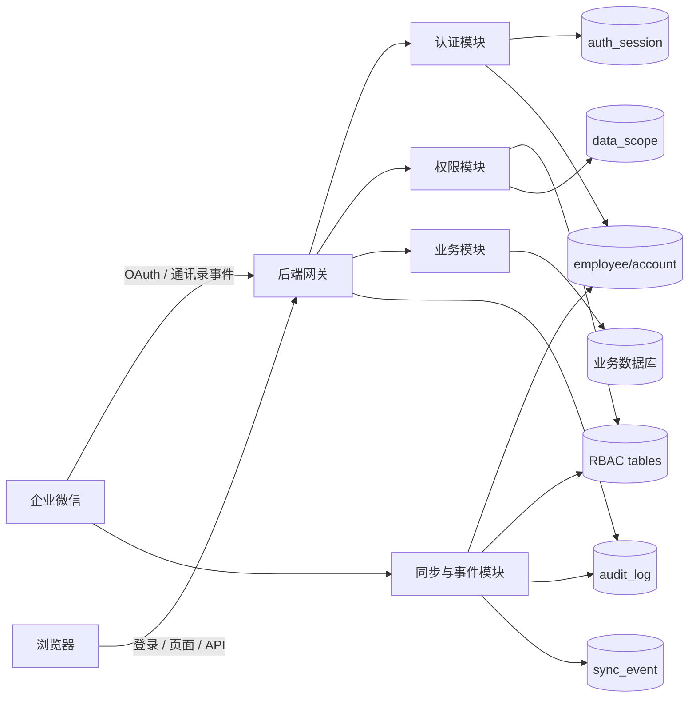
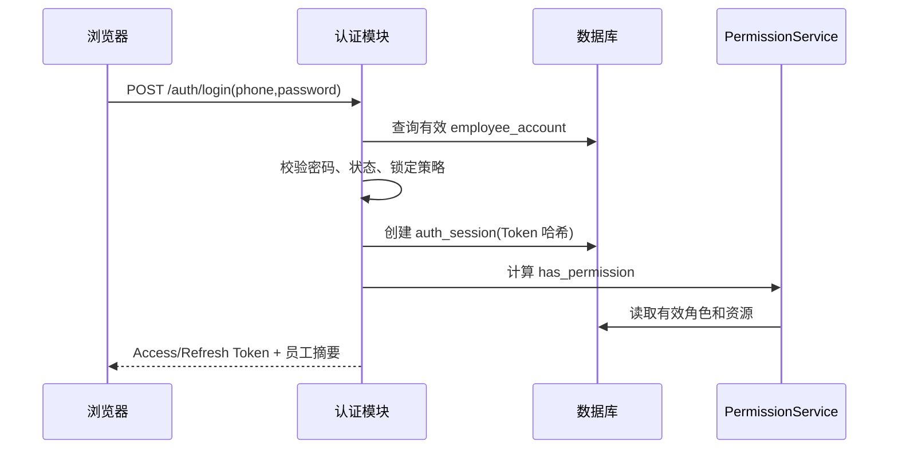
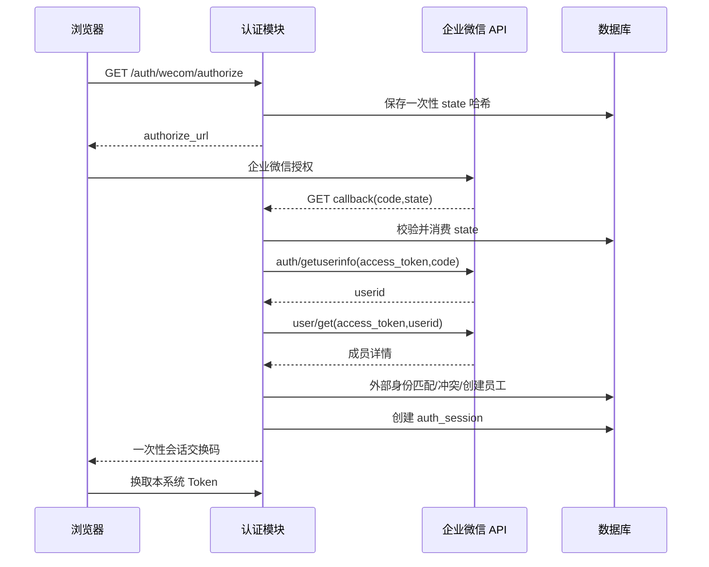
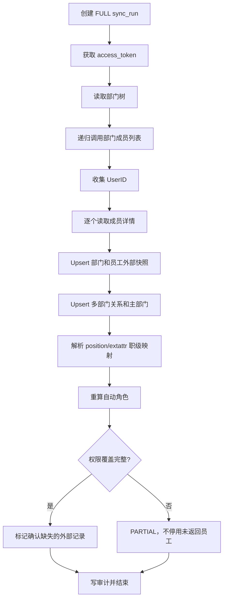
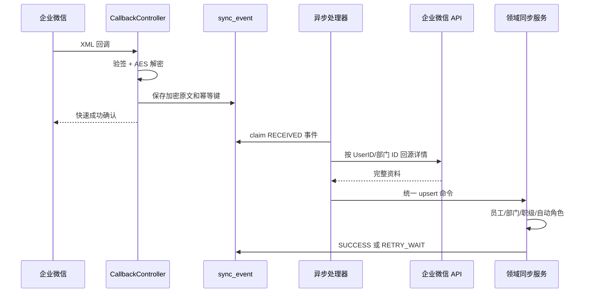
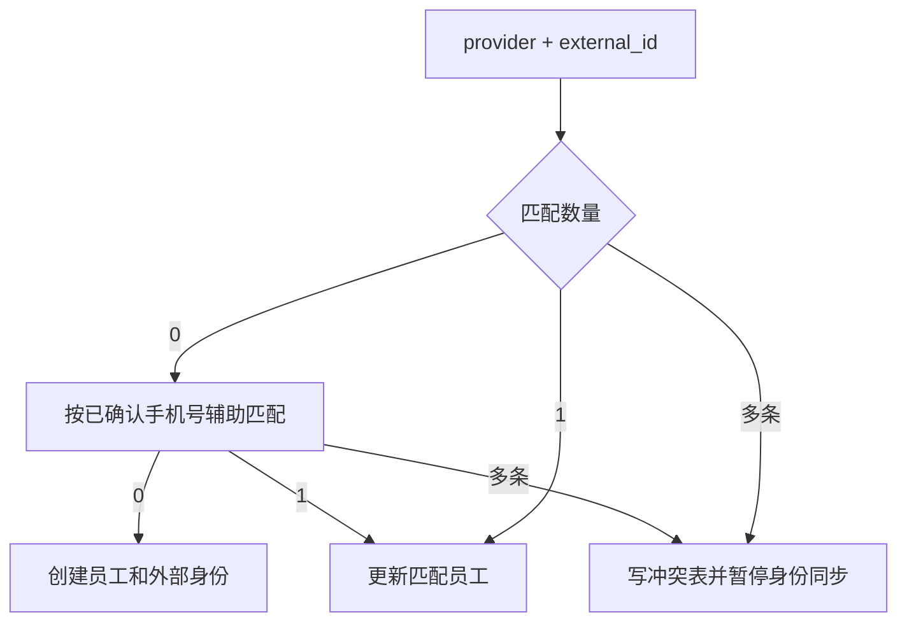
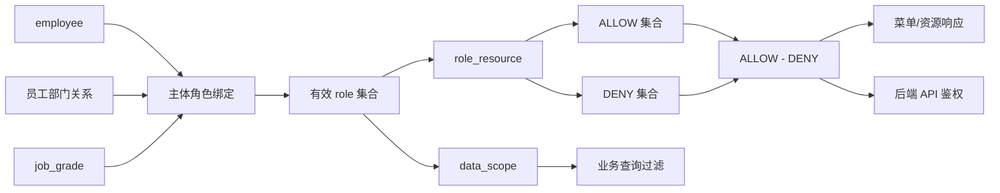
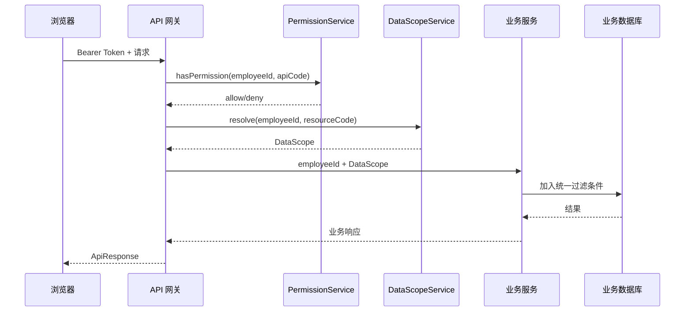
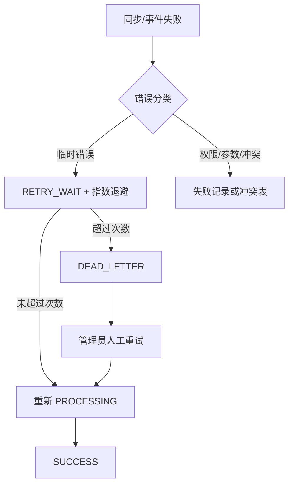

# Seeex 端到端数据流程设计

本文把认证、组织同步、权限计算、动态菜单、业务 API、数据范围和审计串成可执行的数据流。所有企业微信字段以 [官方核对记录](../research/wecom-official-api.md) 为准。

## 1. 总体数据流



系统中有三类事实来源：

| 数据 | 权威来源 | 系统处理 |
| --- | --- | --- |
| 企业微信 userid、部门关系、外部状态 | 企业微信 | 保存外部快照，按同步规则更新 |
| 员工内部展示字段、角色、资源、数据范围 | 系统数据库 | 本地维护 |
| 登录会话、权限快照、当前 Tab | 系统运行时 | 有效期或缓存，不作为组织事实 |

## 2. 本地手机号登录



规则：

1. 不泄露手机号是否存在；
2. 离职、禁用和锁定账号拒绝登录；
3. 无角色仍返回认证成功，但 `has_permission=false`；
4. Access/Refresh Token 只返回一次，数据库只存哈希；
5. 登录成功/失败、锁定和解锁写审计。

## 3. 企业微信 OAuth 登录



外部身份分支：

```text
0 条匹配 → 创建 employee + employee_account + external_identity
1 条匹配 → 更新外部快照并登录
多条匹配 → 写 external_identity_conflict，不自动合并
```

## 4. 企业微信全量同步



全量同步只有在确认应用可见范围完整、分页无错误、无未处理冲突时，才允许把外部确实缺失的员工标记为 `LEFT`。

## 5. 事件增量数据流



事件只携带 ID 时，不得把缺失字段写成空值覆盖已有外部快照。

## 6. 员工匹配与冲突流



姓名永远不能作为自动合并依据。冲突不阻断其他员工同步，当前已有员工账号可以继续使用。

## 7. RBAC 权限计算数据流



有效角色必须满足：未删除、未撤销、在生效时间内、未过期。权限模块向调用方只暴露已计算的快照和判断接口，不暴露授权 SQL 中间结果。

## 8. 动态菜单数据流

```text
请求 /me/menus
→ 加载 employee 有效权限码
→ 加载有效 menu_item + resource
→ 移除不可见、禁用或无页面权限节点
→ 父节点无直接权限但有可见子节点则保留
→ 按 parent_id + sort_order 构建树
→ 返回前端
```

菜单隐藏只影响导航；页面路由和 API 仍必须分别鉴权。

## 9. API 与数据范围数据流



数据范围合并顺序：

```text
ALL > DEPARTMENT_AND_DESCENDANTS > DEPARTMENT > CUSTOM > SELF
```

`CUSTOM` 固定结构：

```json
{
  "department_ids": [10, 20],
  "employee_ids": [1001, 1002]
}
```

业务模块不能直接读取 `scope_config` 或让前端提交 SQL 条件。

## 10. 自动角色和权限缓存流

```text
企业微信职级/部门变化
→ 生成同步批次
→ 撤销当前来源失效的自动绑定
→ 保留 MANUAL 绑定
→ 写入新的 JOB_GRADE/DEPARTMENT/WE_COM 绑定
→ 失效 employee 权限缓存
→ 下一次请求重新计算
```

以下变化必须清理权限和菜单缓存：

- 员工角色变化；
- 部门角色变化；
- 职级变化；
- 职级默认角色变化；
- 角色资源变化；
- 员工部门关系变化；
- 资源/菜单状态变化。

## 11. 失败和恢复数据流



失败时保持已有有效员工、部门和权限数据；权限计算或数据范围服务失败时默认拒绝，不得退化为全部允许。

## 12. 审计数据流

必须写审计的动作：

```text
登录成功/失败
账号锁定/解锁
手机号变更
外部身份绑定/解绑/冲突处理
员工状态变化
角色授予/撤销
资源/菜单变化
职级映射变化
同步开始/完成/失败/重试
企业微信配置变化
事件解密
```

审计写入与关键状态更新必须在同一业务事务中完成；异步事件的接收审计和处理审计分开记录。

## 13. 数据一致性不变量

以下规则必须在服务层测试，并由数据库约束尽量兜底：

1. 有效账号手机号不重复；
2. 员工最多一个有效主账号；
3. 员工最多一个有效主部门；
4. `employee.primary_department_id` 与主部门关系一致；
5. 外部身份多匹配不得自动合并；
6. 员工编号创建后不可修改；
7. 自动同步不得删除人工角色；
8. 未登记 API 默认拒绝；
9. 数据范围解析失败不得返回 `ALL`；
10. 同一事件只能产生一次有效领域变更。

## 14. 端到端验收场景

| 编号 | 场景 | 期望 |
| --- | --- | --- |
| DF-001 | 本地手机号登录 | 创建会话、计算权限、返回员工摘要 |
| DF-002 | OAuth 首次登录 | 回源成员详情并自动建员 |
| DF-003 | OAuth 多身份匹配 | 登录不自动合并，写冲突记录 |
| DF-004 | 全量同步权限不足 | 批次 PARTIAL，不批量停用员工 |
| DF-005 | 重复成员事件 | 只产生一次有效 upsert |
| DF-006 | 更新事件缺少手机号 | 回源详情，不清空已有外部快照 |
| DF-007 | 职级变化 | 撤销旧自动角色，保留人工角色 |
| DF-008 | API 无权限 | 后端返回 AUTHORIZATION_DENIED |
| DF-009 | 数据范围 CUSTOM | 查询只覆盖配置的部门/员工 |
| DF-010 | 处理失败 | 指数重试，超过上限进入死信 |
