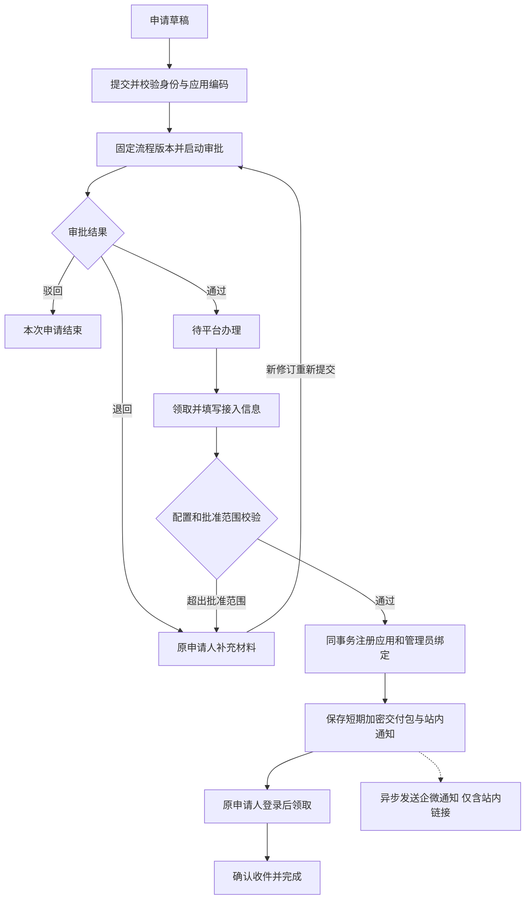

# 新应用接入申请与审批交付设计

日期：2026-11-16。状态：需求及设计完成，待实施；不是已实现功能。

用户已确认：**申请人发起新应用接入申请；平台配置审批流；审批通过后由平台办理人填写接入信息，注册应用并交付给原申请人。** 本设计不把“申请已有应用使用权限”混入首期。

推荐 Flowable 开源流程引擎、受限 bpmn-js 设计器和现有 React/Arco 页面。组件事实和兼容边界见 [审批流组件调研](../research/approval-workflow-components.md)。本轮不改业务代码、依赖或数据库，不运行项目。

## 1 业务范围与角色

| 角色 | 职责 | 限制 |
|---|---|---|
| 申请人 | 保存草稿、提交、补充、撤回、查询本人申请、领取交付、确认收件 | applicantEmployeeId来自会话且不可改；首期不代他人申请，不自行指定审批人或收件人 |
| 审批人 | 查看自己任务的材料，通过、驳回或退回补充 | 同时满足功能权限、任务参与资格和当前有效身份；不能审批本人申请 |
| 平台办理人 | 领取通过审批的办理任务，填写地址等接入配置、完成注册和交付 | 不修改审批意见或已批准的所有者、管理员、入口类型等授权范围 |
| 流程配置员 | 草稿、节点、候选人、条件、时限、校验和预览 | 不能通过设计器上传任意脚本、Java类或外部调用 |
| 流程发布员 | 发布、停用新实例入口、查看版本 | 发布权限单独控制；已启动实例固定版本，不随编辑改变 |
| 流程运维员 | 处理无人审批、失败作业、有效范围内的转办与重试 | 无“任意改为通过”接口；人工处置需理由及审计，不能领取申请人密钥 |

申请人应已有有效平台员工身份。申请人离职/停用时暂停后续办理和领取，进入异常处理，不自动把交付对象改成办理人。负责人调整需要变更申请重新审批，不能直接改原申请人的身份。

首期交付：申请、受限流程设计、审批任务、办理、应用注册、管理员绑定、站内通知、定向交付、确认收件、审计。企微消息通过可配置渠道补充。复杂表单设计器、任意脚本任务、跨租户代办、审批实例热迁移不在首期。

## 2 业务主流程

默认流程模板：申请人 → 申请部门负责人 → 平台接入审批 → 条件触发的安全审批 → 平台办理 → 申请人收件。安全审批的触发依据是已批准的受控风险字段，不由申请人传入“跳过安全审查”开关。

风险级别由平台规则与申请填报共同校验，取平台推导与填报中更严格的一档；生产或新增外部域名等平台强制审核条件不允许被低风险填报覆盖。

部门负责人、平台审核组、安全审核组和办理组均需在发布流程时配置有效来源。不能预设当前数据库已存在这些角色。缺负责人、候选人为空或全部为申请人时转配置的兜底组；兜底仍无人则暂停并通知流程运维员，不能自动通过。

**审批通过、应用注册成功、消息发送成功、申请人已读和申请人已领取是不同事实。** 审批通过后先生成办理任务，不立即创建应用或生成密钥；通知失败不推翻通过结果，不重建应用，也不重复轮换凭证。

## 3 状态与关键流转

申请主状态使用以下值，审批结论另行保留，不能被办理状态覆盖：

| 状态 | 可以发生的动作 | 后续状态 |
|---|---|---|
| DRAFT | 本人保存、提交、删除草稿 | IN_APPROVAL |
| IN_APPROVAL | 有效任务人通过/驳回/退回；本人撤回未决申请 | IN_APPROVAL、REJECTED、RETURNED、PENDING_FULFILLMENT、WITHDRAWN |
| RETURNED | 本人补充及重新提交 | IN_APPROVAL（新修订、新审批尝试） |
| REJECTED / WITHDRAWN | 查看、复制为新草稿 | 原记录不变 |
| PENDING_FULFILLMENT | 办理组成员领取 | FULFILLING |
| FULFILLING | 当前办理人保存配置、校验、完成办理 | PENDING_RECEIPT；失败保留任务及草稿 |
| PENDING_RECEIPT | 原申请人领取交付、确认收件；授权办理人处理过期补发 | COMPLETED，或保持待收件 |
| COMPLETED | 本人查看结果，后续凭证轮换走应用既有管理权限 | 不重开审批历史 |
| EXCEPTION | 运维处理无人节点、身份停用、业务/引擎状态不一致 | 恢复原合法阶段，不允许直接改为通过 |

- 所有动作携带 expectedVersion；更新行状态和版本需CAS。两个审批人或“撤回/通过”并发时只有合法的一方成功，其余409并刷新。
- 多实例会签按ALL、或签按ANY配置；会签一人拒绝即结束该审批节点并按定义终止剩余任务，或签首次有效通过后其他任务失效，全部拒绝才形成驳回；退回与并发通过按版本CAS决定先成立的合法动作，旧任务其余操作409。不能让失效任务继续审批。
- “退回”首期结束当前审批尝试并记录RETURNED。补充重新提交创建新尝试，重新经过全部必要审批，旧意见与实例永久关联；不做任意跨节点跳转。
- 新尝试按当前有效绑定选择流程版本，在提交确认页显示版本变化。一次尝试启动后锁定版本、申请修订及组织上下文快照。
- 未决申请人可撤回；审批最终通过后不再由申请人直接撤回。尚未交付时办理人可依取消办理规则关闭任务并留理由；已生成应用后需走独立应用停用/变更流程，不能静默删记录。

## 4 申请及办理字段

### 申请表

| 字段 | 必填/约束 | 来源和使用 |
|---|---|---|
| requestNo、applicantEmployeeId、departmentId | 服务端生成/派生 | 使用员工当前主部门；多部门员工首期不任意挑选其他部门审批路径 |
| name | 必填1–128字 | 应用名称 |
| proposedAppCode | 必填，复用 `[a-z][a-z0-9-]{1,63}`，排除platform | 提交时校验并预留，办理时再次校验，不能只检查前端可用性 |
| description、businessPurpose | 必填业务用途，分别≤500/2000字 | 只作为业务文本，不能成为表达式代码 |
| type | WEB/ADMIN/AI/OTHER | 业务分类，与实际入口端分开 |
| requestedEntries | 非空WEB/ADMIN集合 | 决定允许配置的入口；现有注册模型要求baseUrl，首期后台申请也必须声明一个合法Web接入地址 |
| environment | DEV/TEST/PROD | 服务端校验合法值，审批条件使用固定枚举 |
| requestedDomains | 预期Web/后台/API域名，受控域名规范 | 批准范围；办理不能悄悄换外部域名或增加未批准入口 |
| requestedAdminEmployeeIds | 默认仅原申请人；如增员须申请时明列并审批 | 不允许办理人临时加自己为应用管理员 |
| dataClassification | INTERNAL/CONFIDENTIAL等平台受控枚举 | 路由规则输入；规则与取值由平台定义 |
| attachmentIds | 可选，最多10个，总量与文件限额一致 | 只能绑定本人已确认的文件；审批附件访问按申请参与者ACL处理 |
| revision、expectedVersion | 服务端/提交动作携带 | 每次有效修订生成不可变申请快照 |

联系方式优先使用员工现有资料，只读展示；不能把任意邮箱、手机号或前端userId直接作为敏感信息接收对象。

### 办理表与交付内容

| 字段 | 约束 | 交付策略 |
|---|---|---|
| appCode、ownerEmployeeId、管理员集合、获批入口 | 来自批准快照，只读 | 变更需重新审批；owner固定原申请人 |
| baseUrl、adminUrl、apiUrl、repositoryUrl、logo | 复用注册服务HTTP(S)校验及长度；地址在已批准域名范围内 | 可作为普通接入信息展示；后台地址需对应获批ADMIN入口 |
| ssoCallbackPath | ≤256字，安全站内路径，无查询串/片段 | 复用现有规则 |
| integrationNotes | ≤2000字，可选 | 禁止填写凭证作为普通说明；按文本展示，禁止任意HTML |
| ciToken、clientSecret | 由注册服务生成，不由办理人手填 | 仅申请人专属加密领取；分别说明CI上报和应用后端使用 |
| SSO/CI/权限校验接入说明 | 由平台模板和最终应用配置生成 | 包含WEB/ADMIN差异、回调及服务接口，不伪装成OIDC |

没有实际部署地址时办理保持未完成，不用示例域名或伪造地址凑齐字段。域名、所有者、管理员或风险分类超出批准快照时生成变更修订并回到审批，不能以“补充信息”为名扩大授权。

## 5 流程配置与发布

每个模板具有 definitionKey、name、businessType=APP_ONBOARDING、version、status、BPMN XML、nodeConfig、formSchemaVersion、checksum、createdBy、publishedBy、publishedAt。发布版本不可改；编辑从其复制成新草稿。停用只阻止新实例，运行实例继续引用旧版本。

发布者需选择业务绑定、适用环境、优先级、启用时间和兜底模板。相同优先级/条件重叠时拒绝发布；提交时必须唯一命中，零命中不能偷偷绕过审批。绑定和流程版本一并记录到申请尝试。

首期节点：

- 开始/结束：唯一可达入口与合法结束。
- 审批：单人、会签ALL、或签ANY；固定员工、角色候选组、申请部门负责人；有效人数和兜底策略明确。
- 条件：只允许固定字段、枚举、数值比较和AND/OR条件；服务端生成白名单表达式，禁止输入任意SpEL/UEL、Bean引用或脚本。
- 办理：固定平台应用办理任务，不能替换为任意类、URL或脚本。
- 通知：只能选择预定义通知类型与收件规则；密钥不进入通知模板或流程变量。
- 计时：超时提醒、升级到指定组；默认只提醒，不自动通过。超时任务失效/转办规则需配置，禁止重复审批。

发布前校验：路径完整、无悬空节点和非许可循环、分支有默认出口、节点均可达、必经办理/交付不被删除、候选人来源有效、申请人自审批排除、节点数量/XML大小/条件深度受限。流程预览只显示经过节点及候选人，不会启动真实实例或发送通知。

## 6 页面及按钮清单

所有列表有分页、筛选、刷新、加载/空/错误态；所有提交失败保留草稿；关联字典失败禁止提交。导航由资源表与 `/me/navigation` 注入，不新增一套静态菜单。

| 页面 | 按钮/交互 | 权限与规则 |
|---|---|---|
| 工作台 → 我的申请 | 新建申请、查询、状态/日期筛选、详情、复制申请 | `app-requests:create`、`app-requests:own:view`；列表强制本人过滤 |
| 申请表 | 保存草稿、校验编码、提交、取消编辑 | 保存/提交分别动作；提交确认显示命中流程及受控权限范围；不允许前端传审批人 |
| 申请详情 | 查看审批图/意见、补充重提、撤回 | 本人且合法状态；撤回/重提确认并CAS；已审批字段不可直接编辑 |
| 工作台 → 我的待办 | 待审批、待办理、已办、抄送分别筛选 | 任务关系决定可见性，拥有按钮权限不等于可看全部任务 |
| 审批详情 | 领取、通过、驳回、退回补充 | 通过意见可选、驳回/退回意见必填≤1000字；过期任务提示并刷新；首期无任意跳转 |
| 办理详情 | 领取办理、保存配置、校验、完成办理并交付 | 仅当前办理人；完成前显示将创建的应用/管理员/领取人确认摘要，不展示明文密钥 |
| 我的申请 → 交付页 | 查看普通接入信息、领取敏感信息、分别复制、确认收件 | 只限原申请人；领取用POST，不用GET；遮罩、超时提示、复制失败可手工复制 |
| 基础平台 → 审批管理 | 全量申请查询、分派办理、异常详情、恢复、提醒 | 单独管理权限与范围，需理由；无批量自动通过 |
| 流程定义 | 新建、复制、保存草稿、校验、预览、发布、停用、历史版本 | 编辑/发布权限分开；发布显示差异与受影响的新申请；运行实例不被覆盖 |
| 设计器 | 添加/删除允许节点、选择审批人、条件、会签规则、超时、缩放、撤销/重做 | 节点右侧Arco属性区；后台再次校验完整模型；保留bpmn.io水印 |
| 通知中心 | 未读/已读、详情、标记已读、跳转申请 | 仅本人；“已读”不等于“已领取/已收件” |
| 交付运维 | 查看非敏感发送状态、重试通知、申请凭证补发 | 重试通知不重建应用/凭证；补发需独立权限和轮换确认 |

组件约定：TreeSelect字符串key，API边界转换数字ID；Switch使用checked；审批时限用InputNumber正整数；状态用明确枚举；设计器在useEffect建立/销毁，版本切换先检查脏数据。流程XML和自定义JSON不作为普通用户主要表单。服务端按允许的节点/属性重建并校验部署模型，拒绝任意class、delegateExpression、executionListener、taskListener、外部实体和自由表达式，不能只检查前端画布。流程图查看不得挂载可编辑modeler。

## 7 后端模块与事务

在 web 内新增 `workflow`、`applicationrequest`、`notification`、`delivery` 包，业务DO/Mapper仍用MyBatis-Plus。引擎使用Flowable BPMN Java API，所有浏览器请求通过平台Controller和业务授权服务，不直接暴露引擎REST。

职责建议：

| 服务 | 职责 |
|---|---|
| WorkflowDefinitionService | 草稿、受限模型校验、版本、部署、绑定 |
| WorkflowInstanceService | 启动、任务操作、候选人解析、历史、超时与异常 |
| ApplicationRequestService | 本人申请、修订、编码预留、业务状态和参与者ACL |
| ApplicationFulfillmentService | 办理配置校验、批准范围、调用现有注册、绑定管理员 |
| DeliveryService | 加密交付、本人领取、过期、收件、补发与撤销 |
| NotificationService / OutboxWorker | 站内通知、企微适配、幂等、重试/死信 |

编码预留的app_code是唯一锁入口：存量应用迁移为REGISTERED预留，所有直建/办理注册都必须在事务中校验预留归属并转为REGISTERED。紧急override也不能抢占其他活跃申请编码；需先按合法业务状态取消原申请。活动审批/办理预留由后台续期，终态释放未注册编码，退回保留期默认7天、到期可释放并在重提时重新抢占；不因预留过期绕过重新审批。

首期引擎与业务共享DataSource和Spring事务管理器，凭证只在本地注册事务中产生。引擎表由引擎API维护；禁止业务Mapper读写ACT_*表。生产关闭引擎自动建表/改表，使用核对过的版本DDL部署；不能声称无代码集成即可运行。Jackson 2/3与MyBatis-Plus共存是实施前核对点。

完成办理时，在一个事务中校验版本/身份/批准快照，创建应用、管理员绑定、加密交付记录、站内消息、通知Outbox，并完成办理任务。任一步失败整体回滚，申请仍可安全重试。事务不得同步调用企业微信等外部HTTP接口。

业务和引擎的最终结论须在同事务更新；引擎作业/监听器若在异步事务执行，由持久化业务事件和幂等键衔接。增加周期对账，发现运行任务与业务阶段不符时进入EXCEPTION，禁止只改单个状态字段。

审批任务端点的expectedVersion是平台任务投影版本，并同时依赖引擎原生乐观锁；申请端点使用申请版本，办理端点使用办理版本，交付端点使用交付版本。禁止把一个对象的版本号用于另一个对象的CAS。

## 8 数据模型

以下是待实施模型，不在本轮生成或执行SQL。数据库不设外键，关联在事务中验证。

| 表 | 核心字段与唯一性 |
|---|---|
| app_onboarding_request | id、request_no唯一、applicant_employee_id、department_id、state、decision、current_revision、row_version、current_attempt_id、result_app_code、created_at、updated_at、deleted_at（仅草稿软删除） |
| app_request_revision | request_id+revision唯一、schema_version、申请字段JSON、批准范围/组织上下文快照、checksum、submitted_at；提交后不可改 |
| app_request_attempt | request_id+attempt_no唯一、revision、definition_version_id、engine_instance_id唯一、business_key唯一、status、started_at、ended_at |
| app_code_reservation | app_code唯一、request_id、revision、status、expires_at、row_version；提交/撤回/驳回/办理按状态释放或转正式注册 |
| wf_definition / wf_definition_version | key/业务类型、version、状态、bpmn_xml、node_config、校验摘要、部署ID、发布者；key+version唯一 |
| wf_business_binding | business_type、scope、priority、condition_config、effective_at、definition_version_id；冲突绑定校验 |
| wf_task_projection | 引擎task_id唯一、instance/attempt、node_key、state、candidate_snapshot、assignee_employee_id、due_at、row_version；只作平台查询投影，不代替引擎判定 |
| wf_action_log | task_id、actor、action、comment、source、occurred_at、decision_revision、idempotency_key；不可覆写历史 |
| app_fulfillment | request_id唯一、claimed_by、配置草稿、approved_revision、result_app_code、status、row_version、completed_at |
| app_delivery | request_id+delivery_version唯一、recipient_employee_id、普通交付信息、secret状态、expires_at、revealed_at、acknowledged_at、row_version |
| delivery_secret | delivery_id+credential_type唯一、ciphertext、nonce、key_id、expires_at、redeemed_at；无密钥明文与普通查询返回 |
| inbox_message | recipient+event_key唯一、request_id、消息类型、标题/摘要、read_at；payload禁止密钥 |
| notification_outbox | event_key+recipient+channel唯一、状态、attempt_count、next_attempt_at、lease_until、last_error、row_version；payload仅非敏感通知与站内链接 |
| request_attachment | request_id+file_id唯一、owner_employee_id、用途、状态；不能把任意文件ID当成可公开附件 |

现有 application_registry 增加 originating_request_id 唯一关联；重复完成办理只返回同一应用和交付状态，不再次注册。现有应用管理员关系只绑定审批快照批准的人员，不影响平台角色。

## 9 API契约

统一 `/api` 前缀，ApiResponse仍为code/message/data/error_type；分页page/pageSize，返回items/total。所有写操作有版本检查，危险动作有审计。下表的权限名为待新增资源，不表示当前已授权。

| 方法与路径 | 主要参数 | 权限及返回 |
|---|---|---|
| POST `/app-requests` | 申请表业务字段 | create；服务端设置本人；返回requestId/no/state/version |
| GET `/me/app-requests` | page/pageSize/state/keyword/from/to | own:view，强制本人 |
| GET `/app-requests/{id}` | 无身份入参 | 本人、当前/历史任务参与者或有范围权限的管理员；返回脱敏申请、历史、allowedActions |
| PUT `/app-requests/{id}/draft` | fields、expectedVersion | 本人DRAFT/RETURNED；返回新版本 |
| POST `/app-requests/{id}/validate` | expectedVersion | 本人；编码、范围和命中流程预检，不创建实例 |
| POST `/app-requests/{id}/submit` | expectedVersion；Idempotency-Key头 | 本人；重新校验编码、组织、模板；返回attemptId/state/version |
| POST `/app-requests/{id}/withdraw` | reason、expectedVersion | 本人且未决；同步终止当前尝试 |
| DELETE `/app-requests/{id}/draft` | query expectedVersion | 仅本人未提交草稿；历史修订不可删除 |
| GET `/me/approval-tasks` | category/state/page/pageSize | tasks:view；强制本人有效任务/候选范围 |
| POST `/approval-tasks/{id}/claim` | expectedVersion | 候选组任务CAS领取，不能抢占已分配任务 |
| POST `/approval-tasks/{id}/decision` | APPROVE/REJECT/RETURN、comment、expectedVersion | tasks:act并验证本人任务、仍有效身份与实例状态；不接收任意流程变量 |
| GET `/workflow/instances/{id}/diagram` | 无 | 同申请ACL；返回只读图与节点状态，不含凭证或全部引擎变量 |
| GET `/application-fulfillments` | page/pageSize/state | fulfill:view及办理范围 |
| POST `/application-fulfillments/{requestId}/claim` | expectedVersion | fulfill:act，办理组有效成员 |
| PUT `/application-fulfillments/{requestId}/config` | 接入字段、expectedVersion | 当前办理人，仅批准范围 |
| POST `/application-fulfillments/{requestId}/complete` | expectedVersion；Idempotency-Key | 当前办理人；返回appCode/deliveryId/state，不回传明文密钥 |
| GET `/me/app-deliveries/{requestId}` | 无 | recipient=当前本人；返回普通接入信息、可领取状态、过期时间 |
| POST `/me/app-deliveries/{requestId}/redeem` | deliveryVersion、expectedVersion；Idempotency-Key | recipient本人且有效；事务CAS；Cache-Control:no-store；响应含分别标识的凭证 |
| POST `/me/app-deliveries/{requestId}/acknowledge` | deliveryVersion、expectedVersion | 本人确认，已读通知不能替代此动作 |
| POST `/application-fulfillments/{requestId}/reissue` | reason、expectedVersion、明确轮换确认 | delivery:reissue，旧凭证按选择立即失效；新交付仍只给原申请人 |
| GET/POST `/workflow/definitions` | 筛选或模板基本信息 | definitions:view / write |
| PUT `/workflow/definitions/{id}/draft` | model、nodeConfig、expectedVersion | definitions:write；受限模型、字典验证 |
| POST `/workflow/definitions/{id}/validate` 或 `/preview` | 草稿版本、样例非敏感字段 | definitions:write；不启动真实实例或通知 |
| POST `/workflow/definitions/{id}/publish` 或 `/disable` | expectedVersion、reason | definitions:publish；不修改运行实例版本 |
| GET `/me/inbox`、POST `/me/inbox/{id}/read` | 分页筛选/版本 | 只读写本人消息；不能更换收件人 |
| POST `/notification-jobs/{id}/retry` | reason、expectedVersion | notification:operate；只重试同一消息，不生成新应用/凭证 |

审批/办理/领取的allowedActions由服务器计算，前端只用于展示。所有候选人、角色、部门、文件和配置选项接口按相应业务范围裁剪；不能因为下拉框需要数据就开放全部组织敏感资料。

写接口错误：字段/模型校验400，未登录401，无任务或对象资格403（必要时统一404避免枚举），对象不存在404，状态/版本/幂等内容冲突409，已过期交付409并返回稳定业务码DELIVERY_EXPIRED（error_type=CONFLICT），限流429。DELIVERY_EXPIRED在实施时加入错误码枚举，复用现有冲突状态映射。

## 10 定向交付与凭证规则

“发送到申请人手里”默认由持久化站内交付实现，通知中心提供明确入口；企微通知配置后异步补充。同一交付对象始终是不可变的原申请人，不允许办理人随意输入收件人。

1. 注册服务在完成办理时返回的新凭证由同事务交付服务接收，以AES-GCM加密、单独key_id和随机nonce短期存放；应用表仍只存校验摘要。不得存入流程变量、操作日志、消息正文或普通附件。
2. 默认领取有效期24小时，作为可配置业务默认值，不是组件自带保证。过期后删除密文并提示申请补发；只有已完成注册的元数据保留。
3. 登录并验证recipient后才可领取；GET展示普通接入信息，POST以CAS消费。并发领取只有一次成功；关闭后不提供明文回查。收到通知链接本身不代表具有访问资格。
4. 明文只保存在当前页面内存，不进入URL、localStorage、会话录屏或前端错误上报。领取响应no-store、页面禁止缓存；复制失败可手动复制。站内通知/企微消息只发受控链接。
5. 领取成功后响应丢失视为已消费，不承诺网络层严格一次可见；用户通过受控补发流程恢复。补发意味着相应旧凭证轮换失效，需提示已接入服务的影响；通知重试绝不触发补发。
6. “首次交付”是当前摘要存储模型之上的新能力，不能沿用原创建接口先把明文给办理人，再宣称只有申请人看过。申请办理路径的响应必须只返回脱敏元数据。
7. 现有直接注册、修改管理员、轮换凭证接口必须重新审视：默认启用审批注册入口，普通注册不能绕过批准记录；运维紧急直建使用单独override权限及理由。原有凭证轮换仍会给有权限的应用管理员返回新凭证，因此本规则保证的是首次办理交付的接收边界，不声称平台高权限管理员永远无法轮换凭证。

通知Outbox：事务提交后发送，按event_key+recipient+channel去重；失败指数退避、达到次数进入死信、可人工重试。以租约/CAS抢占工作，重试不依赖内存。站内已持久化、外部渠道发送状态、消息已读和凭证已领取分别记录。

## 11 权限及附件边界

- 工作流管理员不自动成为应用管理员；审批人不因看材料而获得CI/服务凭证。申请创建权不等于platform:apps:create。
- 新应用尚未存在时，不能用“所属应用管理员”兜底新申请权限；首期使用审批业务自己的申请人、任务参与者、办理组关系。
- 模板操作权限不等于所有实例数据可见。实例、图、历史、附件、消息及交付均需相同对象ACL；禁止以可猜ID跨人访问。
- 首期不能跨企业租户。企业范围来自可信会话/部署配置，不能接受请求头任意tenantId；当前平台主要为单企业，接口设计不假装已经有完整多租户隔离。
- 私有文件当前按“应用+租户+所有者”隔离，审批人不能直接复用原上传人的下载接口。附件需新增受控代理下载/授权上下文：先校验申请参与关系，再校验附件确实绑定该申请且上传归属正确，file服务只接受可信后端的限定读取上下文。不得为方便审批把文件改PUBLIC或接受浏览器自报ownerId。
- 审批意见、字段、域名条件和BPMN XML均按输入处理；XML禁外部实体，发布白名单模型；普通流程配置不允许脚本、Java委托类、任意HTTP任务和凭证变量。
- 凭证加密存储使用独立环境密钥，记录key_id便于轮换；不复用企微Secret。审计记录谁做了什么、请求/实例/节点/交付版本与结果，不记录明文密钥。

## 12 幂等与异常处理

提交幂等：employee+action+Idempotency-Key绑定requestId、revision、正文hash和attemptId；重复相同请求返回原结果，不同内容409。办理关联originating_request_id唯一，防止响应丢失后重复注册。

同意/驳回、领取、完成和撤回均校验任务版本及实例阶段。任务资格同时参考任务候选快照和当前员工状态；角色/人员移除后不放行旧JWT。候选人离职或角色清空走有审计的转派/暂停，不自动通过。

注册失败：业务/引擎同事务回滚，保留办理草稿，展示可读错误。审批通过后应用编码冲突：保持待办理，重新选择编码属于批准内容变更，重新审批。没有可用流程、模板停用、域名越界、附件失效均明确提示，不展示假成功。

已创建应用但通知失败：保留应用与交付；站内仍可领取，仅重试通知。已领取但未确认：显示待收件确认，不能再次显示原密钥。申请人停用：阻止领取并冻结交付，超期清除密文，人工处置不得直接改收件人。

## 13 实施顺序与验收

1. 核对并固定引擎/设计器依赖，定义受限模型；更新工程规范中的引擎持久层例外；编写未执行的迁移。
2. 申请、修订、编码预留、本人ACL和固定默认模板；打通提交→待办→审批结果，先不生成应用。
3. 后端办理事务接入现有注册和管理员服务；限制旧直建旁路；实现加密交付与站内消息。
4. 补齐申请、待办、办理、交付和流程配置页面；属性选择树及服务器错误态逐按钮对应。
5. 加入Outbox、企微可配置消息、超时提醒、异常对账、附件授权和补发。
6. 核对下列用例并编写必要回归源码；用户仍要求不运行时，运行验收保持未执行。

验收用例至少包括：

- 正常申请到本人收件；Web/后台双端信息及不同用途凭证准确。
- 驳回无应用/密钥；退回重新审批全部必要节点；撤回与最后通过并发只有一个结果。
- 空审批人、自审批、离职审批人、会签拒绝、或签失效任务、超时升级。
- 模板变更不影响在途；新尝试按新绑定重新显示流程版本。
- 非本人查询、审批、附件下载、领取和消息读取全部拒绝；流程运维员也不能领取他人密钥。
- 相同幂等提交只建一个实例，相同办理只建一个应用；正文变化使用相同幂等键409。
- 办理超出批准域名、入口、管理员集合时拒绝并要求重新审批。
- 注册任一步失败无半成品应用/管理员/交付；通知失败不重建、不轮换。
- 凭证不在日志/变量/消息/URL；并发领取CAS、过期、响应丢失和受控补发可恢复。
- CSV/审计等现有导出不能导出delivery_secret明文；所有错误可见且不清空草稿。

运行验收、真实通知、引擎事务行为、候选组件兼容性和浏览器视觉效果本轮均未验证；本设计不以静态文档替代这些验收。
