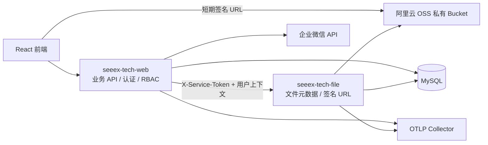
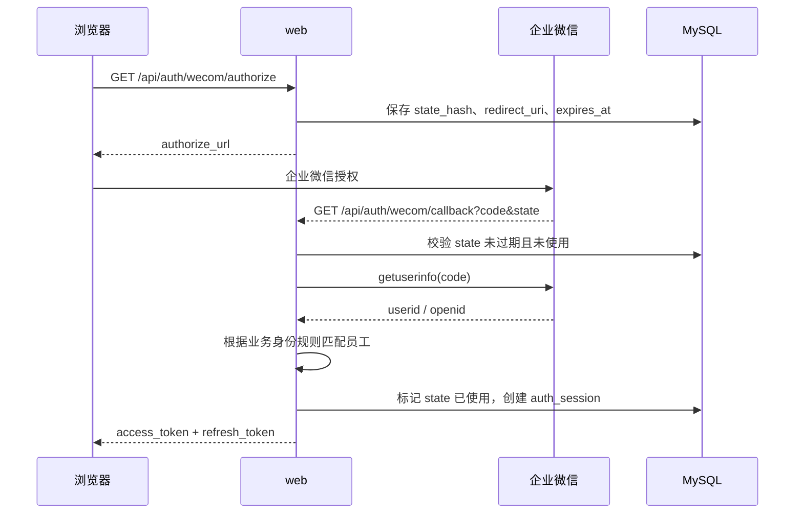
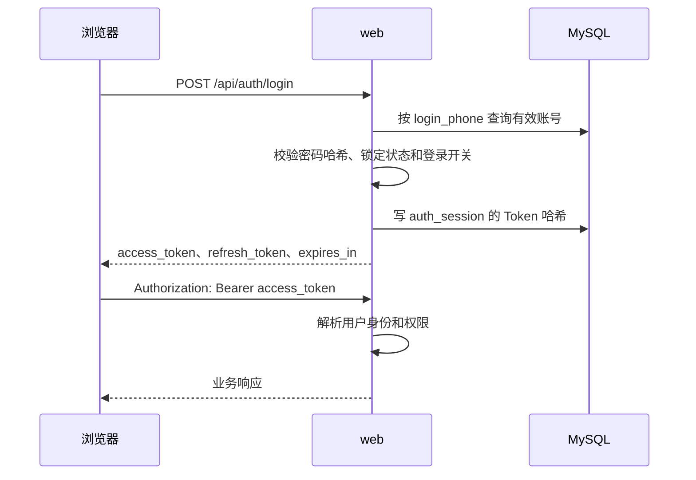
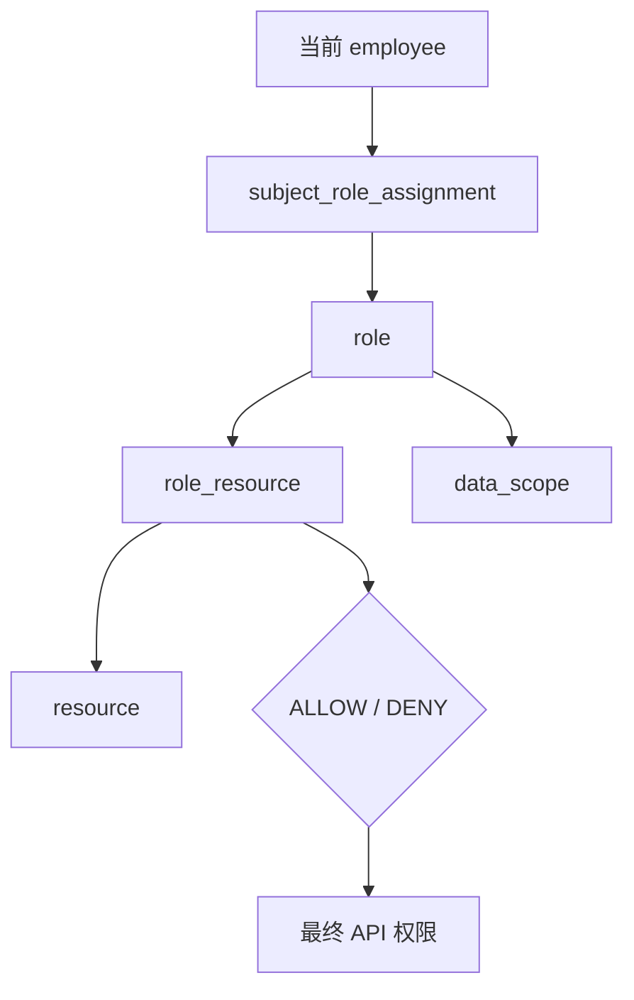
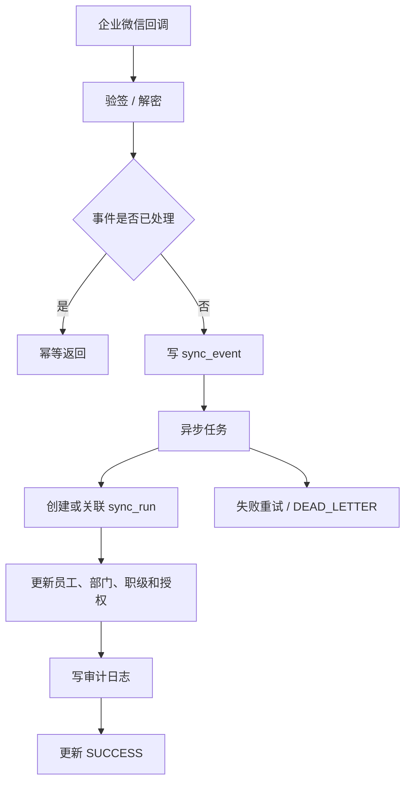
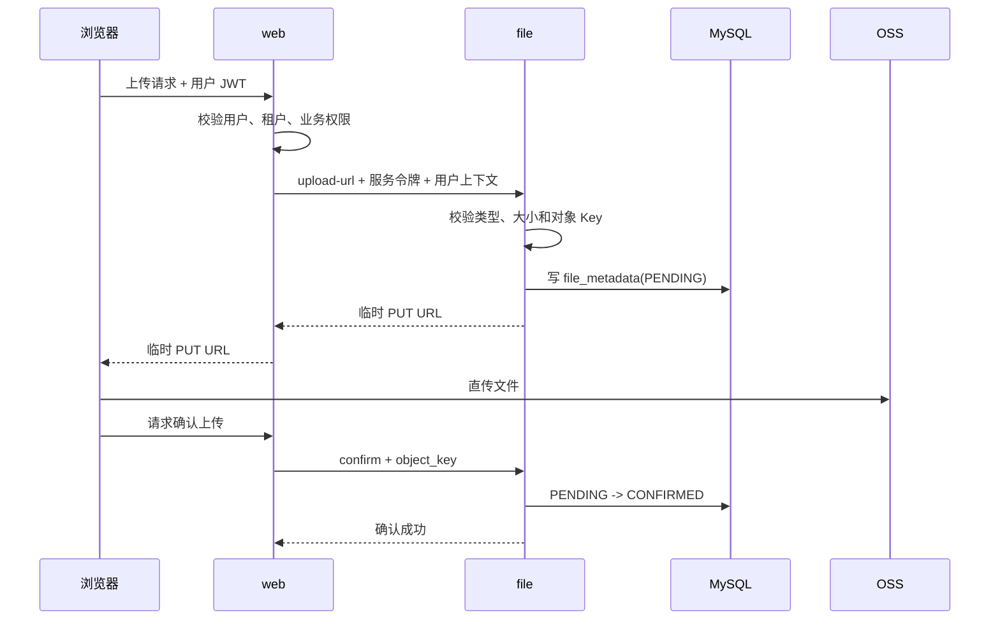
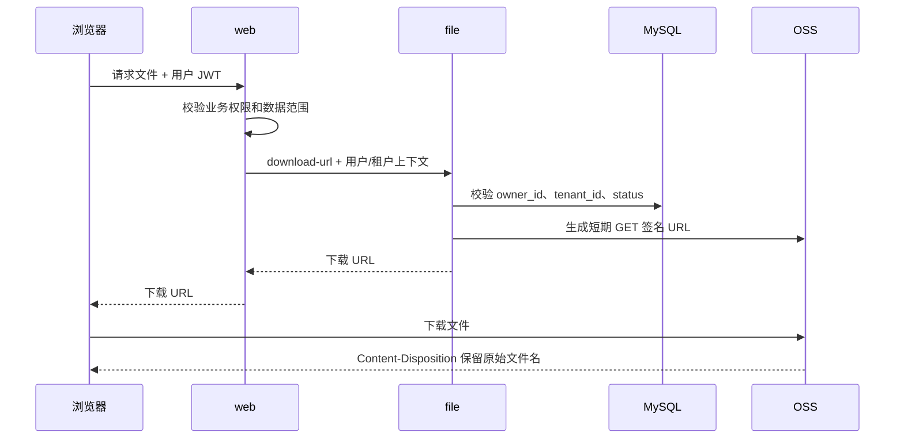
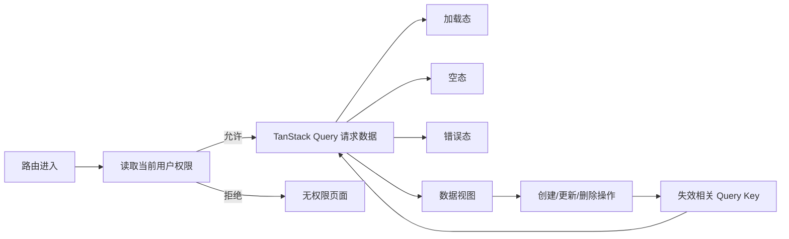

# Seeex 技术架构与端到端数据流设计

## 1. 文档定位

本文档是 Seeex 当前阶段的技术方案基线，连接前端、业务后端、独立文件服务和 MySQL 数据模型。文档中的接口、服务边界和数据流以当前代码仓库为基础，并为 RBAC、企业微信认证/同步和文件服务的后续实现提供落地顺序。

当前代码仓库：

- 前端：`D:\seeex\code\seeex-tech-ui`
- 后端：`D:\seeex\code\seeex-tech`
- 设计文档：`D:\seeex\code\docs`

## 2. 当前技术基线

### 2.1 前端

| 项目 | 当前选择 |
|---|---|
| 构建 | Vite 8 |
| 语言 | TypeScript 6 |
| UI | React 19 + Arco Design |
| 路由 | React Router 7 |
| 服务端状态 | TanStack Query 5 |
| 表单 | React Hook Form + Zod |
| HTTP | Axios |
| 图标 | Lucide React |
| 样式 | Tailwind CSS 4 + 项目 CSS |

当前前端已有 `src/lib/api.ts`、路由、布局和占位页面。后续业务页面应沿用 React Router、TanStack Query 和统一 Axios 封装，不在页面中直接拼接请求地址。

### 2.2 后端

| 项目 | 当前选择 |
|---|---|
| 运行时 | Java 21 |
| 框架 | Spring Boot 4.0.9 |
| 构建 | Maven 多模块 |
| 模块 | `common`、`web`、`file`、`ai` |
| Web | Spring MVC |
| ORM/SQL | MyBatis-Plus 3.5.18 |
| 数据库 | MySQL 8.0+ |
| 迁移 | Flyway MySQL |
| 安全基础 | Spring Security |
| 观测 | Actuator + Micrometer Tracing + OpenTelemetry OTLP |
| 文件存储 | 阿里云 OSS 独立文件服务 |

### 2.3 服务边界



`web` 是业务入口，负责用户认证、权限计算、业务事务和企业微信同步。`file` 是独立部署的文件服务，负责 OSS 凭证、文件元数据和文件访问授权。业务服务不直接持有 OSS AccessKey。

## 3. 统一接口协议

所有业务 JSON 使用统一响应结构：

```json
{
  "is_success": true,
  "code": "OK",
  "message": "success",
  "data": {}
}
```

错误响应：

```json
{
  "is_success": false,
  "code": "RESOURCE_NOT_FOUND",
  "error_type": "NOT_FOUND",
  "message": "资源不存在"
}
```

`code` 是稳定的具体错误码；`error_type` 是错误分类；`message` 是安全的展示文本。HTTP 状态码仍然是传输层语义。

当前前端 `src/lib/api.ts` 仍保留 `error_message` 字段，和后端协议不一致；实施阶段需要先删除该字段，或者在兼容窗口内将它标记为废弃字段。当前方案以 `message` 为唯一展示消息。

## 4. 认证模型

### 4.1 用户访问业务服务

```text
Authorization: Bearer <access_token>
```

`web` 验证 Access Token，解析：

```text
employee_id
tenant_id
roles
permissions
```

用户身份不由前端自行传递的 `X-User-Id` 决定。

### 4.2 业务服务访问文件服务

```http
X-Service-Token: <service-token>
X-User-Id: <resolved-user-id>
X-Tenant-Id: <resolved-tenant-id>
```

第一版使用服务令牌和可信用户上下文 Header。正式环境可将用户上下文升级为内部 JWT，文件服务校验签名、租户、用户和资源权限。

## 5. 登录与企业微信 OAuth 流程



约束：

- `state` 只能使用一次。
- OAuth secret、企业微信 Token、AES Key 只保存在服务端密钥引用中。
- Access Token 和 Refresh Token 只保存哈希。
- 未匹配到内部员工时返回 `AUTHENTICATION` 或业务错误，不自动创建未知外部人员。

## 6. 本地账号登录流程



## 7. RBAC 权限计算



权限计算规则：

```text
ALLOW = 员工、部门、职级获得的有效 ALLOW 权限并集
DENY  = 有效 DENY 权限并集
FINAL = ALLOW - DENY
```

权限查询必须同时检查：

- 当前时间是否在 `effective_at` 和 `expires_at` 范围内
- 授权是否已撤销
- 角色和资源是否有效
- 数据范围是否允许访问目标数据

数据库不使用外键，应用层必须在授权写入、撤销和查询时验证逻辑关联。

## 8. 企业微信同步流程



企业微信同步只维护内部员工、部门、职级和授权关系，不建立独立外部人员表。事件原文需要加密保存，普通前端接口不能读取。

## 9. 文件上传流程



文件 Key 由 `file` 服务生成：

```text
tenants/{tenantId}/{bizType}/{ownerId}/{yyyy}/{MM}/{uuid}/{normalizedFileName}
```

客户端不能指定 Bucket 或最终对象 Key。业务表只保存 `file_metadata.id` 或稳定文件引用。

## 10. 文件下载流程



下载前必须满足：

```text
tenant_id 匹配
owner_id 或业务授权匹配
status = CONFIRMED
文件未逻辑删除
```

## 11. 文件数据模型

当前文件表为 `file_metadata`，核心字段：

```text
idempotency_key
tenant_id
owner_id
biz_type
biz_id
bucket_name
object_key
file_name
content_type
file_size
etag
sha256
visibility
status
storage_class
created_at
confirmed_at
deleted_at
updated_at
```

文件状态：

```text
PENDING -> CONFIRMED -> DELETED
```

## 12. 前端页面与 API 组织

当前前端路由仍以 `AdminLayout` 和 `RoutePlaceholder` 为主，真实业务路由需要按业务域逐步补齐。规划的目录和查询键如下：

```text
src/features/auth
src/features/rbac
src/features/employee
src/features/wecom
src/features/files
```

页面只通过 API client 调用后端：

```text
Axios interceptor
  -> 注入 Authorization
  -> 统一处理 401/403
  -> 解析 ApiResponse
  -> TanStack Query 缓存和失效
```

前端权限只负责展示和交互，后端必须对 API 再次校验权限。

## 13. 平台基础前端结构、页面和菜单

本节只定义平台基础和系统管理能力，不代表完整业务产品的最终菜单。业务域页面应在独立业务模块中扩展，并复用本方案提供的认证、RBAC、文件、审计和组织能力。

### 13.1 平台基础一级菜单

| 菜单 | 路由 | 页面职责 | 权限码 |
|---|---|---|---|
| 平台工作台 | `/` | 系统健康、待办、同步状态和最近操作 | `platform:dashboard:view` |
| 员工管理 | `/employees` | 员工列表、详情、启停用和账号状态 | `employees:view` |
| 组织管理 | `/departments` | 部门树、部门成员和负责人 | `departments:view` |
| 职级管理 | `/job-grades` | 系统职级和企业微信职级映射 | `job-grades:view` |
| 角色权限 | `/rbac/roles` | 角色、资源、ALLOW/DENY 授权 | `rbac:roles:view` |
| 资源管理 | `/rbac/resources` | 菜单、页面、按钮和 API 资源 | `rbac:resources:view` |
| 企业微信 | `/wecom` | 企业微信配置、连接状态和授权入口 | `wecom:config:view` |
| 同步中心 | `/wecom/sync` | 同步批次、事件、失败重试和死信 | `wecom:sync:view` |
| 文件中心 | `/files` | 文件列表、归属、状态、下载和删除 | `files:view` |
| 审计日志 | `/audit-logs` | 登录、授权、同步和文件操作审计 | `audit:view` |

这些菜单属于平台基础层，主要服务系统管理员、组织管理员和集成管理员。菜单仅用于导航显示，真正的页面和 API 访问必须由后端权限校验决定。菜单树由后端返回，前端根据 `resource_type=MENU` 和 `is_visible` 渲染。

业务模块的菜单应使用独立前缀，例如：

```text
业务中心       /business
客户管理       /business/customers
订单管理       /business/orders
```

业务模块不得把业务页面直接混入平台基础组件目录；它们通过公共认证、权限和文件客户端接入平台。

### 13.2 页面设计约束

- 所有页面使用浅色背景，禁止深色背景作为页面、导航栏、卡片或弹窗的底色。
- 页面背景使用浅灰或白色，内容卡片使用白色，边框和分割线使用低对比度灰色。
- 主题色只用于按钮、链接、选中态、状态标签和图表强调，不大面积铺满页面。
- 不提供深色模式切换；已有主题配置中的 `sidebar` 必须改为浅色值。
- 页面统一采用“页面标题 + 工具栏 + 内容区 + 分页/状态栏”结构。
- 列表页面必须支持加载态、空态、错误态、权限不足态和分页态。
- 详情页面使用分组卡片展示基础信息、状态信息、关联数据和审计记录。
- 删除、撤销、重试、同步等高风险操作必须使用确认弹窗并说明影响范围。
- 文件下载、企业微信 Secret 和 Token 等敏感信息不得在页面中展示明文。

### 13.3 页面功能设计

平台工作台展示系统健康、待处理同步事件、最近登录、权限变更和文件处理状态；员工管理提供搜索、状态筛选、部门筛选、详情查看、账号启停用和角色查看；RBAC 页面提供角色到资源的授权矩阵，并明确显示 ALLOW、DENY 和有效期；同步中心提供批次状态、失败原因、重试操作和事件详情；文件中心显示原始文件名、业务归属、文件状态、大小、上传时间和可用操作。业务域页面由各业务模块自行定义。

### 13.4 前端状态和交互



## 14. 可观测性

- `web` 服务名：`seeex-tech-web`
- `file` 服务名：`seeex-tech-file`
- 日志包含 `traceId` 和 `spanId`
- Actuator 提供健康检查、指标和 Prometheus 端点
- 业务服务调用文件服务时透传 trace context
- 审计日志保存 `request_id`，并与 traceId 建立查询关联

## 15. 实施顺序

1. 完成 MySQL Flyway 基础表和字段注释。
2. 在 `web` 实现统一认证、会话和用户上下文。
3. 实现 RBAC 权限计算和数据范围过滤。
4. 实现企业微信 OAuth 回调和同步任务。
5. 完善 `file` 服务的元数据确认、下载权限和清理任务。
6. 前端接入登录、权限菜单、员工和文件页面。
7. 增加跨服务集成测试、同步幂等测试和文件访问权限测试。

## 16. 当前实现边界

当前代码已经具备：

- Spring Boot 多模块启动骨架
- MySQL 驱动和 Flyway MySQL 依赖
- 统一 API 响应和错误码
- 独立 `file` 服务
- OSS 临时上传/下载 URL
- 文件元数据和用户/租户上下文字段
- 前端 React/Vite 基础布局和 API 依赖

仍需实现：

- 真正的 JWT/OIDC 登录认证
- RBAC 表对应的 Mapper、Service 和 API
- 企业微信 OAuth Controller 和同步任务
- 文件服务与业务权限的完整联动
- MySQL Flyway 按版本拆分的正式迁移
- 前端真实业务页面和权限路由
